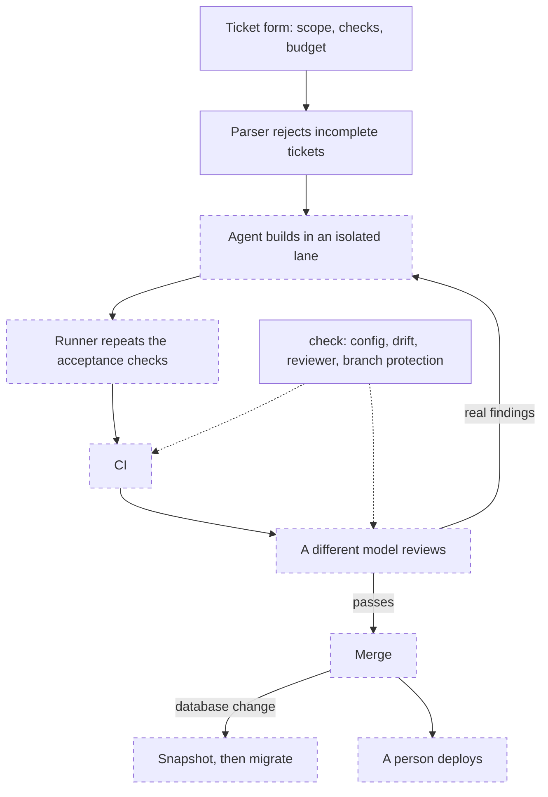

# Agent pipeline

Agent pipeline turns a GitHub issue into a scoped, checkable task that an AI agent can build. It also checks that a repository has the guardrails I want in place, including a reviewer that is never the model that wrote the code.

## What is in this repo

This is the reusable core: the ticket form, the ticket parser, the config schema and the `init` and `check` commands. The agent runner, the review and migration workflows and the deploy script live in the private app where I run the full flow. In the diagram, solid boxes are in this repo and dashed boxes are not.

## The flow



## How to run it

You need Node.js 18 or newer. `check` also needs the [GitHub CLI](https://cli.github.com), signed in.

```sh
git clone https://github.com/JR-BEI/agent-pipeline.git
cd agent-pipeline
npm install
npm test

# Add the pipeline to a project. Commit your work there first.
bin/pipeline init ../my-project

# Check its config and guardrails
bin/pipeline check ../my-project

# Also list old automation that could be removed (deletes nothing)
bin/pipeline check ../my-project --inventory
```

**`init` replaces files.** It overwrites or deletes content at the paths it owns, including `.github/workflows/ci.yml`. It prints its plan but does not ask for confirmation. It never overwrites an existing `AGENTS.md` or `pipeline.yml`.

A new project will fail `check` until you fill in the checklist that `init` prints. Every setting is explained in [docs/configuration.md](docs/configuration.md), and there is a [complete example](test/fixtures/full-pipeline.yml).

To parse a ticket, run this inside the target project:

```sh
node scripts/lane/ticket-parse.mjs 42 example-org/example-app
```

It prints the ticket as JSON, or lists what is wrong and exits with an error. The optional environment variables are in [.env.example](.env.example).

## Guardrails and why they exist

| Guardrail | Why | Where |
|---|---|---|
| A ticket needs a spec, acceptance checks, allowed paths and a budget | An agent needs a definition of done it cannot argue with | Enforced here by the parser |
| A model cannot be assigned to review its own work | A model is likely to miss the same thing twice | Enforced here by `check` |
| The main branch must require `ci` and `review` | A check that can be skipped is only advice | Checked here through GitHub |
| Shared files must match the template | Small local edits add up until no two projects work the same way | Checked here |
| Config rejects unknown fields and bad values | A typo should fail early instead of turning a rule off | Enforced here by `check` |
| Writes cannot escape the target folder or follow a linked folder | Tooling that deletes files should have a hard boundary | Enforced here by `init` |
| Cleanup only makes suggestions | A wrong guess should cost nothing | Enforced here |
| Time, spending and review limits | A stuck agent should stop and ask for help | Settings here, time and review limits enforced by the private runner |
| Compare old and new code on real data | Tests can pass while real results get worse | Settings here, run by the private runner |
| Check the database project before touching it | A valid password can still be for the wrong database | Setting here, enforced in the private app |

## What I learned running it on real projects

The full flow runs in a private Next.js and Supabase app.

**The first real ticket needed a person to finish it.** The runner blocked several times on lane setup, failed checks and review rounds, and I landed the change by hand. One early build passed every acceptance check, but the sandbox would not let the agent commit. The runner now commits for it.

**Passing tests was not enough.** On that same ticket, comparing the old and new parser over 4,653 saved pages turned up three regressions. They were fixed before merge. That comparison became a pipeline step.

**A correct credential can point to the wrong place.** For about two days the migration tooling pointed at the wrong database project. What looked like schema drift was a different database. The project ID is now pinned, and the scripts refuse any other.

**Reviewers need to show evidence.** I changed review so a speculative comment cannot block a merge. A blocking finding has to point to real data, a regression, the spec or a written standard.

**A usage limit is not a build failure.** Moving to a stronger model does not fix an empty quota. The runner now stops and says why.

**Agents do not need the same review for every change.** I started by requiring a second model on everything. Today CI gates normal changes, and second-model review is kept for migrations and scripts that write to production. Tickets that go through the runner keep their own review loop. I merge migrations and run deploys myself.

That last change is also a known gap: `check` still expects both `ci` and `review` on every project, so it is stricter than how I work today.

---

Built by [John Ross](https://github.com/JR-BEI). Released under the [MIT license](LICENSE).
